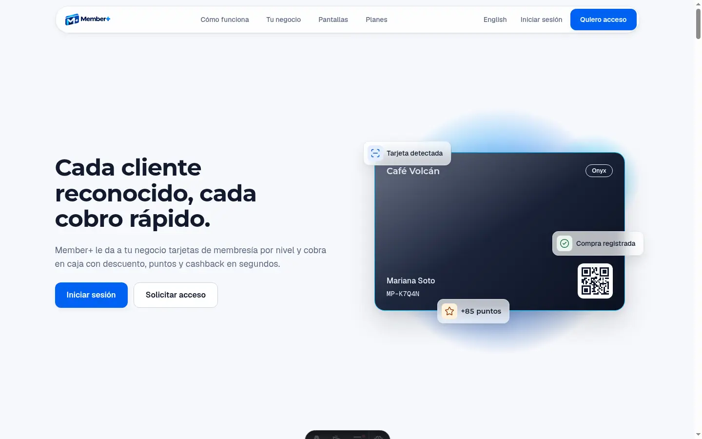

<p align="center">
  <picture>
    <source media="(prefers-color-scheme: dark)" srcset="brand/logo-on-dark.png">
    <source media="(prefers-color-scheme: light)" srcset="brand/logo-on-light.png">
    
  </picture>
</p>

<h3 align="center">Member+ · Landing</h3>

<p align="center">
  <em>Cada cliente reconocido, cada cobro rápido.</em><br>
  Sitio público de Member+ · Universidad Tecnológica de Tijuana · grupo 9C
</p>

<p align="center">
  <a href="https://github.com/AGA-Studio/Member-Plus-Landing/actions/workflows/ci.yml"></a>
  <a href="docs/DEPLOY.md"></a>
  <a href=".github/workflows/ci.yml"></a>
  
  <br>
  <a href="https://astro.build"></a>
  <a href="https://react.dev"></a>
  <a href="https://www.typescriptlang.org"></a>
  <a href="https://tailwindcss.com"></a>
  <a href="https://nodejs.org"></a>
  <a href="https://nginx.org"></a>
</p>

---



Member+ es una plataforma SaaS donde cada negocio administra sus clientes, tarjetas de membresía por
nivel y compras con descuento, puntos y cashback. Esta landing es la cara pública: presenta el producto
y manda al visitante a **iniciar sesión** o a **solicitar acceso**.

Es un sitio **100 % estático**: Astro compila HTML, CSS y JavaScript, y nginx sirve el resultado. Aquí
solo hay texto, componentes y capturas; los datos y la sesión viven en la app
([Member-Plus-Frontend](https://github.com/AGA-Studio/Member-Plus-Frontend)) y la lógica, en el API
([Member-Web](https://github.com/AGA-Studio/Member-Web)).

Dos reglas que atraviesan el repositorio:

- **La landing solo reclama rutas públicas.** Comparte dominio con la app (`memberplus.neyzt.org`), así
  que atiende `/`, `/privacidad`, `/terminos`, `/en*`, `/_astro/*`, `/screens/*`, `/robots.txt`,
  `/sitemap.xml` y los íconos. `/login`, `/panel`, `/caja` y el resto son del frontend de Next; el
  reparto lo hace el proxy de Coolify, no el código.
- **Se afirma solo lo que el producto hace hoy.** Sin precios, sin testimonios, sin cifras de clientes:
  todos los negocios y personas de la página son ficticios. Los límites de lo que se puede decir están
  en [`PRODUCT.md`](PRODUCT.md) y no son sugerencias.

## Stack

| Pieza | Versión |
|---|---|
| Astro (salida estática, i18n propio) | 7.4 |
| React (islas) | 19.3 |
| TypeScript estricto | 7 |
| Tailwind CSS vía `@tailwindcss/vite` | 4.3 |
| Animación: `motion` + `lenis` | 14.14 · 1.3 |
| Node | 22 (`.nvmrc`) |
| Servidor de la imagen: nginx | 1.29 alpine |

Sin CDNs, fuentes remotas, analítica ni imágenes de terceros en tiempo de ejecución: todo se empaqueta
en el build, así que la página no depende de nadie más para verse igual.

## Empezar

```bash
npm ci
npm run dev
```

Abre <http://localhost:4321>. No hace falta `.env` ni tener la app levantada: los botones de acceso
salen por `mailto:` y el enlace de sesión apunta al dominio real (`src/config/site.ts`).

Para levantar el API simulado que usa el frontend del producto (negocios y clientes ficticios en el
puerto 8000), en otra terminal:

```bash
npm run mock-api
```

### Origen público, canonical y SEO

`SITE_URL` fija el origen que se escribe en `<link rel="canonical">`, en las etiquetas `hreflang`, en
`robots.txt` y en `sitemap.xml`. Sin la variable, el build local apunta a `http://localhost:4321`; el
CI y la imagen la fijan a `https://memberplus.neyzt.org`, y el job `build` falla si el canonical sale
con otro origen. Para revisar otro dominio:

```bash
SITE_URL=http://localhost:4321 npm run build
```

## Rutas

| Ruta | Qué sirve |
|---|---|
| `/` | Landing en español (idioma por omisión) |
| `/en/` | Landing en inglés |
| `/privacidad` · `/terminos` | Aviso de privacidad y términos en español |
| `/en/privacy` · `/en/terms` | Lo mismo en inglés |
| `/robots.txt` · `/sitemap.xml` | Generados en el build desde `src/pages/` |

Las cuatro páginas legales van con `noindex` y quedan fuera del sitemap; la portada se indexa. El
cambio de idioma es un enlace real, no JavaScript, y cada página declara su `hreflang`, incluido
`x-default`.

## Scripts

| Comando | Qué hace |
|---|---|
| `npm run dev` | Servidor de desarrollo en el puerto 4321 |
| `npm run build` | Build estático a `dist/` |
| `npm run preview` | Sirve `dist/` para revisarlo como quedó |
| `npm run typecheck` | `astro sync && tsc --noEmit` |
| `npm run mock-api` | API simulada para el frontend del producto (puerto 8000) |

## Estructura

```
src/pages/           las seis rutas: español en la raíz, inglés bajo /en/
src/components/      Home, layout y una sección por bloque (hero, cómo, compra, negocio, pantallas…)
src/components/ui/   botones, logo, tarjeta de membresía y badges de nivel
src/islands/         islas React: escenas, decks, caja y animación de scroll
src/product/         la pantalla de caja, portada para mostrarla en la landing
src/product/lib/     cálculo de descuento, puntos y cashback
src/i18n/            es.json y en.json; es.json es la fuente de los tipos
src/styles/          tokens, tipografía y utilidades (global.css)
src/config/          enlaces externos: login y correos de acceso, contacto y soporte
src/lib/             rutas legales, formato, QR, scroll y utilidades de UI
docs/                DEPLOY.md y la captura de portada de este README
tools/               mock-api, capturas de pantalla y comparación de fidelidad (no se publica)
public/              estáticos: capturas del producto, logos e íconos
reference/           BRAND.md y globals.css de la app, como referencia de marca
```

## Contenido y marca

Tres archivos mandan sobre lo que se ve, y no se improvisa:

- [`PRODUCT.md`](PRODUCT.md) — a quién le habla la página, qué se puede afirmar y **qué no** (planes y
  precios, pagos en línea, app móvil, sucursales, reconocimiento facial).
- [`DESIGN.md`](DESIGN.md) y `src/styles/global.css` — tokens de color, tipografía, radios, sombras y
  las excepciones de movimiento. Tema claro por omisión; el oscuro solo con `data-theme="dark"`.
- `reference/` — la marca de la app tal como está en el frontend, para copiar un token en vez de
  inventarlo.

Todo el texto visible vive en `src/i18n/es.json` y `src/i18n/en.json`. `es.json` define el tipo
`Messages`, así que una llave que exista en un idioma y falte en el otro rompe `npm run typecheck`.
La sección de planes es un **marcador**: no hay precios ni nombres de plan todavía, y esa decisión
sigue abierta en la wiki.

## Herramientas

Nada de `tools/` se publica con el sitio; el detalle está en [`tools/README.md`](tools/README.md).

- **`mock-api`** — API falsa en el puerto 8000 con negocios y clientes ficticios. Con
  `API_INTERNAL_URL=http://127.0.0.1:8000` el frontend real del producto corre contra ella.
- **`captures/`** — guiones de `playwright-cli` que guardan las pantallas reales y las codifican a WebP
  en `public/screens/`. Las capturas que se ven en la landing salen de ahí; no se editan a mano.
- **`fidelity/`** — compara con `pixelmatch` la pantalla de caja portada (`src/product/`) contra la real,
  para saber si el mock se desvió.

## Imagen y despliegue

El `Dockerfile` compila con Node 22 y sirve `dist/` con nginx; la imagen final no lleva Node y ronda los
100 MB. Declara su propio `HEALTHCHECK` contra `/healthz.txt`, que nginx responde sin tocar disco.

```bash
docker build --network=host -t memberplus-landing .   # --network=host: DNS del host
docker run --rm -p 8080:80 memberplus-landing
curl -sI http://127.0.0.1:8080/ | head -3
```

`docker/nginx.conf` resuelve las rutas que Astro emite como `directorio/index.html` (`/privacidad` y
`/privacidad/` sirven lo mismo), cachea `/_astro/` para siempre, cachea una hora las capturas y los
logos —el nombre no cambia— y devuelve 404, no un fallback, cuando un archivo no existe.

**Mergear a `main` despliega.** `image.yml` publica `ghcr.io/aga-studio/member-plus-landing` y llama al
webhook de Coolify. Los tags son `sha-<7>` (inmutable, para fijar y revertir), `main`, la versión en los
`v*` y `latest` (móvil, solo en `main`).

En Coolify el dominio de la landing **no** va en el campo *Domains*: se declaran labels con un router de
prioridad alta y la lista exacta de rutas, para no empatar con el router del frontend y depender del
orden en que Traefik carga los contenedores. La landing se indexa; el frontend lleva `X-Robots-Tag` en
su proxy, así que `/login` y `/panel` quedan fuera del índice sin tocar código.

| Ruta del host | La atiende |
|---|---|
| `/`, `/privacidad`, `/terminos`, `/en*` y los assets del sitio | landing |
| `/login`, `/panel`, `/clientes`, `/niveles`, `/movimientos`, `/caja`, `/tarjeta`… | frontend (Next) |
| `/api/*`, `/_next/*` | frontend (Next; `/api` lo reenvía al API) |

Configuración completa, verificación con `curl` y rollback en [`docs/DEPLOY.md`](docs/DEPLOY.md).

## Documentación

- [PRODUCT.md](PRODUCT.md) — producto, audiencia, alcance de lo que se afirma y accesibilidad.
- [DESIGN.md](DESIGN.md) — sistema visual, tipografía y excepciones de la landing.
- [docs/DEPLOY.md](docs/DEPLOY.md) — reparto de rutas en Coolify, labels, verificación y rollback.
- [tools/README.md](tools/README.md) — mock-api, capturas y comparación de fidelidad.
- [Wiki del proyecto](https://wiki.neyzt.org) — requisitos, decisiones y contrato de API.

## Flujo de trabajo

`main` es la única rama: trabajo en `feature/<nombre>`, PR a `main` y merge del equipo. El CI corre
`typecheck`, `build` y `docker` en cada PR; `docker` construye la imagen —sin publicarla— para que un
`Dockerfile` o un `nginx.conf` roto se vea antes del merge.

¿Encontraste un bug o tienes una idea? → [Issues de este repo](https://github.com/AGA-Studio/Member-Plus-Landing/issues). El trabajo planificado por hitos vive en el [tablero Final 9no](https://kan.neyzt.org/member-plus/final-9no) y las decisiones, en la [wiki](https://wiki.neyzt.org).

Proyecto académico de la UTT · *Desarrollo Web Integral* · grupo **9C** · equipo **AGA-Studio**.
